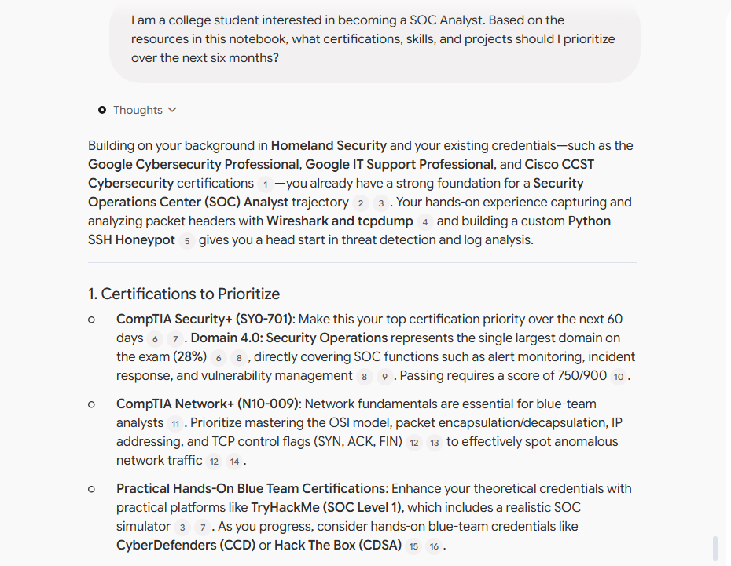
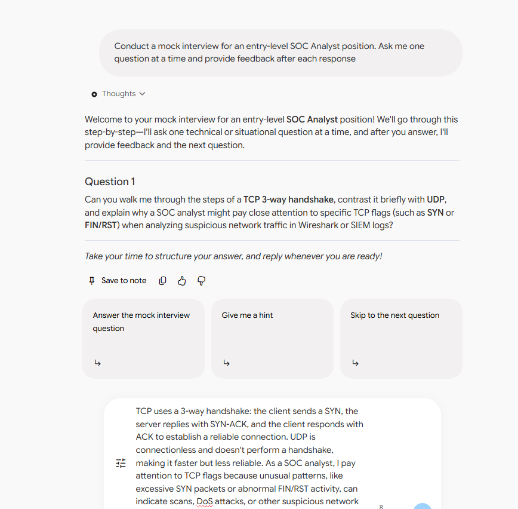
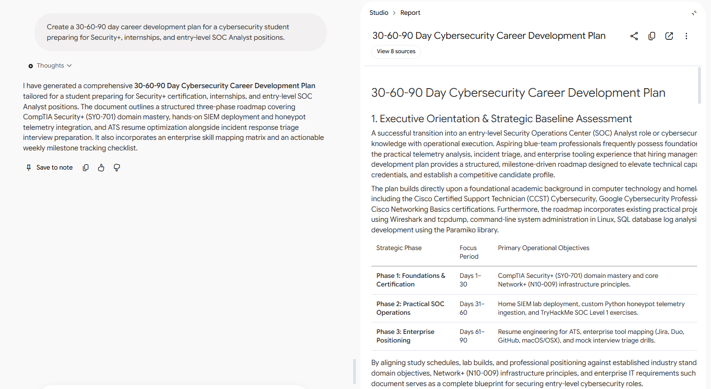

# Sentinel Rising: My LA-Tech AI Navigator

AI Cybersecurity Career Coach built with Google NotebookLM

## Project Overview

Sentinel Rising: My LA-Tech AI Navigator is an AI-powered cybersecurity career coach built using Google NotebookLM. It helps aspiring cybersecurity professionals early on their career like myself to develop career plans, prepare for industry standard certifications, practice technical and behavioral interviews, and better understand cybersecurity concepts with supplemented building hands on project ideas and theory review.

### Career Pathway

Cybersecurity

### Built With

- Google NotebookLM
- Curated cybersecurity resources
- Career development resources
- Certification preparation materials

---

## The Problem I'm Solving

Many students interested in cybersecurity are unsure where to begin. With so many certifications, career paths, job requirements, and technical skills to learn, the process can feel overwhelming. Sentinel Rising helps simplify that journey by providing personalized, trusted source-grounded guidance from cybersecurity professionals and company's in the field today, constanly updated to keep up with emerging adavcnaces and new technologies.

---

## How My AI Career Coach Works

I uploaded career-focused resources into Google NotebookLM, including:

- Security+ Certification Objectives + Practice Exam Questions directly from CompTIA
- Cybersecurity Career Roadmaps by experienced professionals 
- SOC Analyst Job Descriptions
- Interview Preparation Resources
- Intern Resume and Career Development Guides

NotebookLM analyzes these resources and provides responses grounded in the information from the uploaded sources.

---

## My AI Career Coach in Action

### Example 1: Career Guidance

**My Prompt**

> I am a college student interested in becoming a SOC Analyst. Based on the resources in this notebook, what certifications, skills, and projects should I prioritize over the next six months?

**What the AI Helped Me Understand**

The AI identified Security+, networking fundamentals, cybersecurity labs, and hands-on projects as key priorities. It explained how these skills align with common SOC Analyst job requirements and provided a structured learning path.

---

### Example 2: Mock Interview

**My Prompt**

> Conduct a mock interview for an entry-level SOC Analyst position. Ask me one question at a time and provide feedback after each response.

**What I Learned**

The mock interview helped me identify areas where I needed stronger technical explanations. It also gave me practice communicating cybersecurity concepts clearly and professionally.

---

### Example 3: Career Action Plan

**My Prompt**

> Create a 30-60-90 day career development plan for a cybersecurity student preparing for Security+, internships, and entry-level SOC Analyst positions.

**My Next Steps**

The AI broke down my goals into manageable milestones. This made it easier to focus on certifications, practical experience, and internship preparation simultaneously.

---

## Testing and Improving My Assistant

### Original Prompt

> How do I get a cybersecurity job?

### Improved Prompt

> Based on the uploaded cybersecurity career resources, create a step-by-step roadmap for a college student seeking a SOC Analyst internship, including certifications, technical skills, projects, networking opportunities, and interview preparation.

### What Changed and Why

The improved prompt provided more context and specific goals. As a result, the AI generated more detailed, relevant, and actionable recommendations tailored to my career interests.

---

## Responsible AI

To ensure the AI produced reliable and responsible responses, I:

- Compared recommendations against official certification objectives
- Verified career advice using cybersecurity job postings
- Cross-checked information across multiple sources
- Evaluated responses for inaccuracies and unsupported claims

### Information That Should Never Be Shared

- Passwords
- Social Security Numbers
- Banking Information
- Personal Identifiable Information (PII)
- Confidential Company Data
- Client Information

---

## My 30/60/90-Day Career Plan

### 30 Days

- Study Security+ fundamentals
- Strengthen networking knowledge
- Update resume and LinkedIn
- Attend cybersecurity networking events

### 60 Days

- Complete hands-on cybersecurity labs
- Build a home lab
- Practice mock interviews
- Apply for internships

### 90 Days

- Earn or schedule Security+
- Expand portfolio projects
- Apply for additional cybersecurity opportunities
- Continue developing SOC Analyst skills

---

## Reflection

### What was the most useful thing my AI coach did?

The most useful feature was creating a structured cybersecurity roadmap based on trusted sources. It transformed a broad career goal into clear and achievable steps.

### What was one limitation or mistake I discovered?

Some responses were too general when I used vague prompts. More detailed prompts consistently produced better guidance.

### How could this assistant help someone in a real job?

This assistant could support professional development, er planning.

### What would I improve in a future version?

I would expand the knowledge base with additional cybersecurity frameworks, threat intelligence resources, and industry reports.

---

## Skills Demonstrated

- Prompt Engineering
- AI Output Evaluation
- Research and Source Curation
- Responsible AI Practices
- Career Readiness
- GitHub Documentation
- Cybersecurity Career Development
- Technical Communication

---

## About Sentinel Rising

Sentinel Rising: MyLA Tech AI Navigator was inspired by my participation in the LA Tech Rising internship program and my goal of becoming a cybersecurity professional. This project demonstrates how AI can be used responsibly to support career development, continuous learning, and professional growth.
